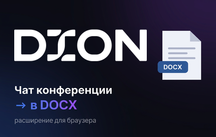
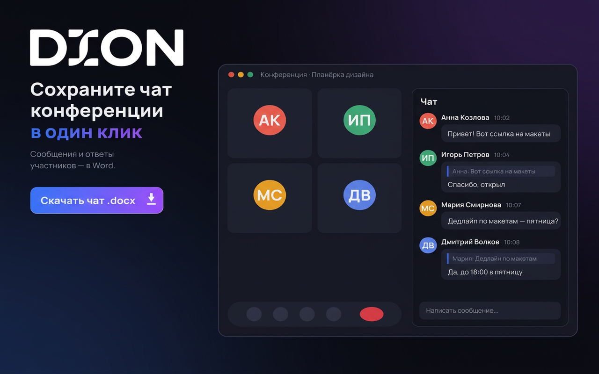
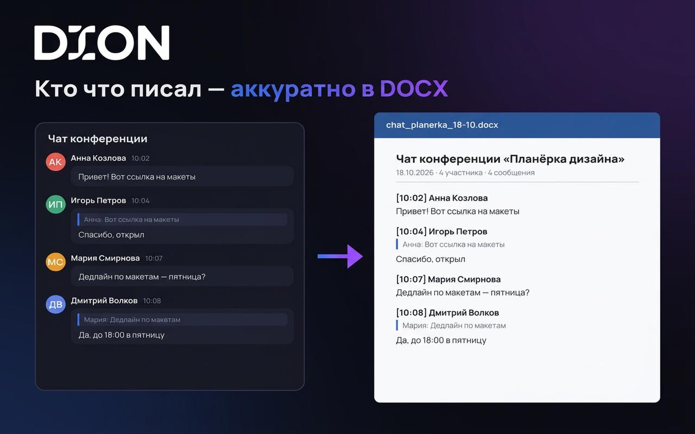

<p align="center">
  
</p>

<h1 align="center">Dion Chat → DOCX</h1>

<p align="center">
  Открытый диалог на <a href="https://dion.vc">dion.vc</a> сохраняется в один файл Word.<br>
  Автор, время, текст, ответы и картинки. Сборка идёт в браузере, на вашем компьютере.
</p>

<p align="center">
  
  
  
  <a href="https://github.com/DrRamm/dion2docx/stargazers"></a>
</p>

<p align="center">
  <a href="#быстрый-старт">Быстрый старт</a> ·
  <a href="#возможности">Возможности</a> ·
  <a href="#что-попадает-в-документ">Документ</a> ·
  <a href="#безопасность">Безопасность</a> ·
  <a href="#установка">Установка</a> ·
  <a href="#разработка">Разработка</a>
</p>

<p align="center">
  Текст на английском: <a href="README.en.md">README.en.md</a>.
</p>

<p align="center">
  
</p>

Штатной выгрузки истории в веб-чате dion.vc нет. Расширение само проходит открытый диалог и складывает его в `.docx` в «Загрузки».

## Возможности

<table>
<tr>
<td width="33%" valign="top">

**Вся история диалога**

Список сообщений на сайте виртуальный: в DOM одновременно видна только часть. Расширение прокручивает его вверх и забирает сообщения по мере подгрузки.

</td>
<td width="33%" valign="top">

**Автор и точное время**

У каждого сообщения — имя и локальное время до секунды, `ДД.ММ.ГГГГ ЧЧ:ММ:СС`. Время берётся из метки сообщения, а не из подписи «10:02» на экране.

</td>
<td width="33%" valign="top">

**Текст и ответы**

Обычный текст сохраняется как есть, с переносами строк. Ответ на сообщение идёт отдельной строкой: `↪ автор: цитата`.

</td>
</tr>
<tr>
<td width="33%" valign="top">

**Картинки внутри файла**

Вложения-картинки вшиваются в документ байтами. Файл открывается и без доступа к dion.vc.

</td>
<td width="33%" valign="top">

**Имя из названия чата**

Файл называется `<название чата> ГГГГ-ММ-ДД.docx`. Внутри — заголовок диалога и строка со временем экспорта, числом сообщений и вложений.

</td>
<td width="33%" valign="top">

**Прогресс на странице**

В правом нижнем углу видно, сколько сообщений уже собрано и сколько картинок читается. Пока идёт экспорт, страница сама прокручивается.

</td>
</tr>
</table>

Кнопка в окне расширения: **Скачать диалог в DOCX**.

## Быстрый старт

1. Поставьте расширение из [готового zip](#готовая-сборка) или [соберите `dist/`](#сборка-из-исходников).
2. Откройте нужный диалог на `dion.vc` под своим аккаунтом.
3. Нажмите иконку расширения и **Скачать диалог в DOCX**.

Файл появится в «Загрузках». Если вкладка с чатом была открыта до установки, обновите её.

## Что попадает в документ

<p align="center">
  
</p>

Документ идёт сверху вниз, от старых сообщений к новым.

```text
Чат конференции «Планёрка дизайна»
Экспорт: 18.10.2026 19:40 · сообщений: 4 · вложений: 0

[18.10.2026 10:02:00] Анна Козлова: Привет! Вот ссылка на макеты

[18.10.2026 10:04:11] Игорь Петров: Спасибо, открыл
    ↪ Анна Козлова: Привет! Вот ссылка на макеты
```

Картинка стоит сразу под своим сообщением. Если байты картинки прочитать не удалось, на её месте строка `[вложение недоступно: <id>]`.

В шапке время экспорта без секунд. У сообщений время полное, в часовом поясе компьютера.

## Безопасность

Переписка остаётся у вас.

- Своего сервера у расширения нет. Аналитики, телеметрии и обращений к сторонним API в коде нет. Текст, авторы и картинки никуда не отправляются.
- Манифест просит четыре вещи: `downloads` (положить файл в «Загрузки»), `offscreen` (сделать временную ссылку на файл: в Manifest V3 service worker сам это не умеет), `scripting` (запустить сборщик на уже открытой вкладке, если браузер не внедрил его сам) и доступ только к `https://dion.vc/*`. Разрешения `storage` нет: между запусками расширение ничего не записывает.
- Сообщения читаются из страницы, которая уже открыта. Картинки берутся из `blob:`-адресов, которые вкладка сама показала после расшифровки. Запасной путь — снять пиксели с уже нарисованной картинки на этой же странице. История чата через API и прямые адреса CDN не запрашиваются.
- Файл Word собирается в браузере библиотекой `docx`. Готовые байты передаются внутри расширения: страница → service worker → offscreen-документ → `chrome.downloads`. Если этот путь не сработал, скачивание идёт обычной ссылкой на той же вкладке.
- Готовый `.docx` лежит в «Загрузках» на вашем диске.

## Установка

Работает в Chrome и в Яндекс.Браузере. Оба грузят расширение как распакованное: магазина Chrome Web Store у проекта нет.

### Готовая сборка

Node.js не нужен.

1. Возьмите архив `release/dion-chat-docx-<версия>.zip`.
2. Распакуйте его в постоянную папку. Потом её нельзя удалять и переносить: браузер читает расширение прямо оттуда.
3. Откройте `chrome://extensions` (в Яндекс.Браузере — `browser://extensions`).
4. Включите **Режим разработчика**.
5. Нажмите **Загрузить распакованное расширение** и выберите распакованную папку. Внутри неё должен лежать `manifest.json`.
6. Обновите вкладку с `dion.vc`, если она была открыта раньше.

### Сборка из исходников

Нужен Node.js.

```sh
npm install
npm run build
```

Дальше те же шаги в браузере, только на шаге 5 выберите папку `dist/`.

Папку `src/` загружать нельзя. Её `content.js` содержит `import` и до сборки как content script не работает. Если такое расширение всё же стоит, окно кнопки прямо напишет, что нужна папка `dist/`.

### Если экспорт не стартовал

Откройте именно диалог, не список чатов. После обновления расширения в `chrome://extensions` подтвердите разрешения и обновите вкладку. Если браузер не внедрил сборщик сам, по нажатию кнопки расширение ставит его на вкладку ещё раз и показывает текст ошибки, если и это не вышло.

## Ограничения

- В файл попадает **открытый** диалог. Список чатов слева не выгружается.
- Короткие диалоги обычно готовы за пару секунд. Длинная история занимает больше: её нужно прокрутить до начала.
- Сохраняются картинки (`img` с подписью `File …`). Голосовые, видео и файлы других типов в документ не входят.
- Нужен выполненный вход в dion.vc в этом браузере. Чужой аккаунт и закрытая вкладка не читаются.
- Если dion.vc поменяет вёрстку, придётся поправить селекторы в объекте `S` в `src/content.js`.

## Разработка

```sh
npm install
npm run build       # dist/
npm run watch       # пересборка при правках
npm run release     # dist/ и release/dion-chat-docx-<версия>.zip
npm test            # Chromium: popup → content script → DOCX
npm run test:yandex:dom
```

Версия в имени архива берётся из `src/manifest.json`. В корне архива лежит `manifest.json`.

Тесты гоняют локальный диалог, без аккаунта Dion. Проверяются виртуальная прокрутка, ответы, время, картинки и скачанный DOCX.

Полный прогон в Яндекс.Браузере один раз готовится так:

```sh
npm run setup:yandex
```

В открывшемся `chrome://extensions` загрузите `dist/` через «Загрузить распакованное расширение», затем запускайте `npm run test:yandex`. Профиль отдельный: `~/.cache/dion-chat-docx/yandex-test`. Обычный профиль браузера не меняется. Другой путь к браузеру или профилю задаётся через `YANDEX_BINARY` и `YANDEX_PROFILE`.

Заметки по вёрстке страницы и сборщику — в [`AGENTS.md`](AGENTS.md).
